# .github
Public Repo for our [Ender-Development](https://github.com/Ender-Development) page. Furthermore it functions as asset storage for various projects.

<div align="center">



</div>

## 

<div align="center">

**Need a server to play on?** Our hosting partner [Akliz](https://www.akliz.net/enderman) has got you covered.

[](https://www.akliz.net/enderman)

Servers in [US](https://www.akliz.net/enderman) · [Europe](https://www.akliz.net/enderman-eu) · [Oceania](https://www.akliz.net/enderman-oce)

</div>

---

<div align="center">

```
  /\_/\   thanks for stopping by       
 ( o.o )  contributions, coffee and cat
  > ♥ <   pictures always welcome      
```

<sub>spilled beans everywhere · supervised by cats · © Ender-Development.org</sub>

</div>
