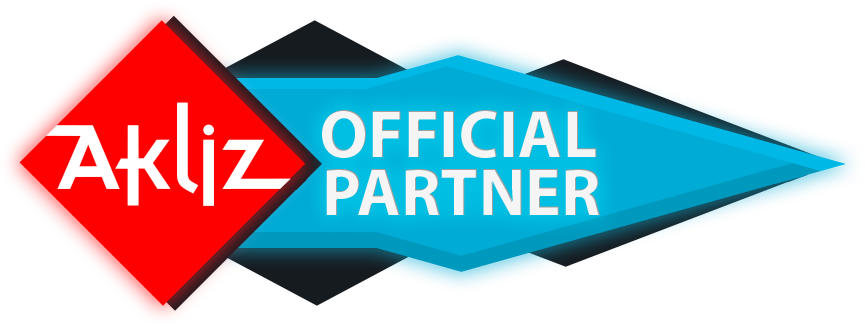

# .github
Public Repo for our [Ender-Development](https://github.com/Ender-Development) page.

## Partnership with Akliz

> It's a pleasure to be partnered with Akliz. Besides being a fantastic server provider, which makes it incredibly easy
> to set up a server of your choice, they help me to push myself and the quality of my projects to the next level.
> Furthermore, you can click on the banner below to get a discount. :')

If you aren't located in the [US](https://www.akliz.net/enderman), Akliz now offers servers in:

- [Europe](https://www.akliz.net/enderman-eu)
- [Oceania](https://www.akliz.net/enderman-oce)
