<div align="center">



[](https://github.com/Ender-Development?tab=repositories&q=&type=source&language=java)
[](https://github.com/Ender-Development?tab=repositories&q=&type=source&language=kotlin)


</div>

---

> Founded September 2020 so two friends could work on projects together. By September 2025 we had accumulated enough projects that roz joined us to keep everything running. Mostly we build Minecraft mods - always open source, always brewed with care. ☕

## 

- [**Enderman**](https://github.com/MasterEnderman) - Founder, Blogger, Dev
- [**Klebestreifen**](https://github.com/Klebestreifen) - loafing around most of the time
- [**roz**](https://github.com/rozbrajaczpoziomow) - eats the code of Enderman, uses an _opinionated_ `.editorconfig`

## 

*What we serve:*

| Serving | Meaning |
| --- | --- |
| ☕ **ours** | Projects of our own, built because we wanted them |
| 🔧 **maintained** | Projects we keep alive: bugfixes, updates, care |
| 📬 **commissions** | Small builds for others, when the pot has room |

<!-- BEGIN:projects -->
*(this section will be generated automatically - current versions and all; nothing to see here yet)*
<!-- END:projects -->

## 

We take on a small number of commissions at a time, so each gets proper attention. If your project fits, tell us what you have in mind and we'll see if there's room in the pot.

**Good fits**
- small unmaintained mods, that deserve some love
- fixes for existing mods
- things we'd be proud to put our name on

**Not for us**
- commissions with impossible deadlines
- still active maintained projects
- large projects (we already have enough of those)
- anything that wouldn't align with our general view of things

**Keep in mind**
- code will stay open source and under our organization
- commission will be published to Modrinth / CurseForge by us (you'll still be added to the project)
- we are programmers not artists

**Reach us:**
- 💬 Discord - ping Enderman in:
  - [](https://discord.gg/JF7x2vG)
  - [](https://discord.gg/bj6FXsRjtp)
  - [](https://discord.gg/f2K4aSpG4F)
- 🦋 Bluesky - [@enderman.ender-development.org](https://bsky.app/profile/enderman.ender-development.org)
- ✉️ Mail - [info@ender-development.org](mailto:info@ender-development.org)

*(No DMs please - pings in public channels or mail work better for everyone.)*

## 

1. Everything we do is open source. Check the repos, poke around.
2. Found a bug? Open an issue - repro steps and a stack trace is always appreciated.
3. Contributions of every size are welcome, typo fixes included.
4. We're slow sometimes. That's life, not disinterest. A friendly ping is fine.

## 

[](https://ender-development.org)
[](https://bsky.app/profile/ender-development.org)
[](https://www.curseforge.com/members/enderdevelopment/projects)
[](https://modrinth.com/user/MasterEnderman)

## 

<div align="center">

**Need a server to play on?** Our hosting partner [Akliz](https://www.akliz.net/enderman) has got you covered.

[](https://www.akliz.net/enderman)

Servers in [US](https://www.akliz.net/enderman) · [Europe](https://www.akliz.net/enderman-eu) · [Oceania](https://www.akliz.net/enderman-oce)

</div>

## 

Most of our code is **LGPL-3.0-only**, some is MIT - each repo states its own license. Art is usually shared under the same license as its project; where it differs, it's stated.

---

<div align="center">

```
  /\_/\   thanks for stopping by       
 ( o.o )  contributions, coffee and cat
  > ♥ <   pictures always welcome      
```

<sub>spilled beans everywhere · supervised by cats · © Ender-Development.org</sub>

</div>
